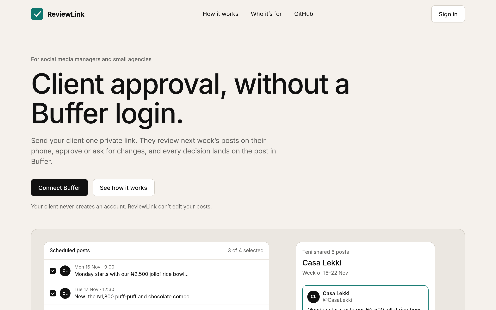
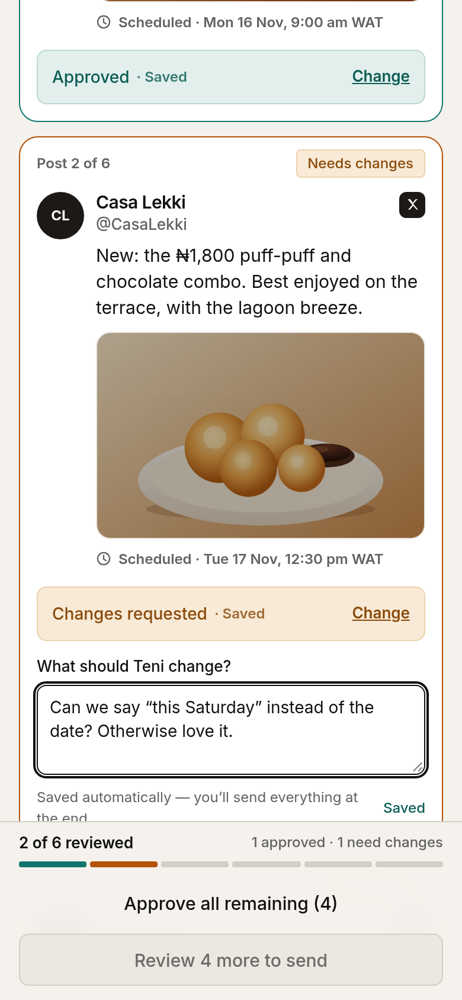
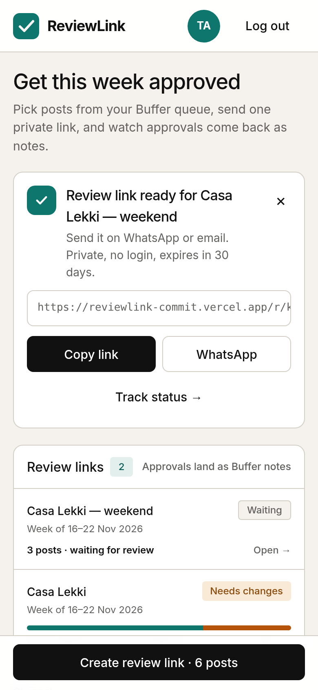

# ReviewLink

**Client approval without a Buffer login.** Share one private link. Your client approves or requests changes on next week's posts from their phone, and every decision lands back in Buffer as a collaboration note.

**Event:** [Buffer Commit](https://buffer.com/api/commit) 2026 · **Live:** https://reviewlink-commit.vercel.app · **How it's built:** [/#how-its-built](https://reviewlink-commit.vercel.app/#how-its-built)



<p>
  
  &nbsp;
  
</p>

## For judges (2 minutes)

1. Open https://reviewlink-commit.vercel.app and click **Connect Buffer** (OAuth with your own Buffer account; schedule a post or two first if your queue is empty).
2. On the dashboard, pick the week, keep the scheduled posts ticked, and click **Create review link**. Copy the link.
3. Open the link in a private window or on your phone. No login. Fill in **Step 1 · Tell us who's reviewing**, **Approve** some posts, **Request changes** on one and type a comment, then tap **Send decisions** at the bottom.
4. Back in the dashboard, open the link's status: per-post approved / changes / pending, with the Buffer note sync state.
5. Open the post in Buffer (publish.buffer.com) and you'll see the note, e.g. `✅ Approved by Ngozi via ReviewLink`.

## The problem

Freelancers and small agencies schedule a client's week in Buffer, then chase approval over WhatsApp screenshots and scattered messages, and re-type feedback into Buffer by hand. Clients don't have, or want, a Buffer seat.

## What it does

- **Dashboard:** lists your scheduled posts for a channel and date range; select posts and create a private review link, then copy it or share it on WhatsApp.
- **Public review page** `/r/<token>`: mobile-first feed of the posts as they'll appear on X, with scheduled times in the viewer's own time zone.
  - **Step 1 · Tell us who's reviewing:** a required name card. Tapping a decision without a name focuses and highlights it.
  - **Step 2 · Review each post:** two neutral outline buttons, ✓ Approve and ✎ Request changes. Once chosen, they're replaced by a tinted status row ("Approved · Saved" in teal or "Changes requested · Saved" in amber) with a **Change** link, so a decision reads as a saved state, not another button to press.
  - Change requests need a comment, which auto-saves (debounced, with a "Saved" indicator) and survives a reload on that device. After each decision the page scrolls to the next unreviewed post.
  - The only primary action is **Send decisions** in the bottom bar, with progress and "approve all remaining". A thank-you screen follows.
- **Write-back:** each decision becomes a Buffer collaboration note on that post.
- **Status view:** per-link progress (approved / needs changes / pending), note sync status, resync, and revoke.
- Expired, revoked, and invalid link states. Links expire after 30 days.

## How it uses the Buffer API

All calls go to Buffer's GraphQL API at `https://api.buffer.com` from server-side route handlers (`lib/buffer.ts`).

| Buffer feature | Where it's used |
| --- | --- |
| OAuth 2.0 Authorization Code + PKCE (S256), confidential client, `offline_access` | `lib/oauth.ts`, `app/api/auth/*`; rotating refresh tokens behind a Redis single-flight lock |
| `account` query (organizations) | Signing in and choosing the org |
| `channels` query | Channel picker, avatars, time zones, paused/disconnected handling |
| `posts` query, scheduled, filtered by `dueAt` | Dashboard list; re-fetched on the server when a link is created, so the client-supplied text is never trusted |
| `createCollaborationNote` with `subject: { postId }` | `lib/write-notes.ts`: one note per decision, e.g. `✏️ Changes requested by Ngozi: … (via ReviewLink)` |
| `collaborationNotes` query | Status view read-back and duplicate-free retries (finds an existing ReviewLink note before writing) |

**Scopes:** `account:read posts:read notes:read notes:write offline_access`. There is deliberately no `posts:write`: ReviewLink can't create, edit, or delete your posts.

```
Manager ──Connect Buffer──▶ Buffer OAuth (code + PKCE) ──▶ ReviewLink (snapshot of scheduled posts)
                                                               │  private link /r/<128-bit token>
                                                               ▼
                         Buffer Notes ◀──createCollaborationNote── Client decisions (no login)
```

## Stack

- **Next.js 16 App Router + TypeScript + Tailwind CSS 4**, deployed on **Vercel** (serverless route handlers, middleware guarding `/app`)
- **Upstash Redis** for sessions, encrypted OAuth tokens, review links, locks, and rate limits
- **Buffer GraphQL API**
- Design system in `DESIGN.md` (editorial cream canvas, white hairline tiles, charcoal primary, Inter at 500 for display, one teal accent); mobile-first at 390px

## Security and privacy

- Buffer access and refresh tokens are **AES-256-GCM encrypted at rest** and never sent to the browser. The session cookie only holds a random session id (`__Host-`, HttpOnly, Secure, SameSite=Lax).
- Review links use **128-bit random tokens**, stored only as **SHA-256 hashes**, expire after 30 days, and can be revoked.
- Public payloads are checked so they never contain tokens or account ids. Decisions are length-validated and **rate-limited per link**. Writes run under a per-review lock, and an identical resubmit is idempotent.
- Privacy page: https://reviewlink-commit.vercel.app/privacy

## Run locally

Buffer requires **HTTPS** redirect URIs, including on localhost. Prerequisites: Node 20+, a Buffer API app client, and Upstash Redis (optional locally; it falls back to in-memory).

```bash
git clone https://github.com/AshThunder/reviewlink
cd reviewlink
cp .env.example .env.local   # fill in values, never commit them
npm install
npm run dev:https            # https://localhost:3000
npm test                     # unit tests for tokens, validation, note text, secret stripping
```

Register `https://localhost:3000/api/auth/callback` as a redirect URI on your Buffer app client.

| Variable | Purpose |
| --- | --- |
| `BUFFER_CLIENT_ID` / `BUFFER_CLIENT_SECRET` | Buffer app client (the secret stays server-only) |
| `BUFFER_REDIRECT_URI` | Exact OAuth callback URL |
| `APP_URL` | Public origin, used for review links |
| `SESSION_SECRET` | Signs the short-lived PKCE cookie |
| `TOKEN_ENC_KEY` | 32-byte hex key for AES-256-GCM |
| `UPSTASH_REDIS_REST_URL` / `UPSTASH_REDIS_REST_TOKEN` | Redis (or `KV_REST_API_URL` / `KV_REST_API_TOKEN`) |

In development, `/preview/review` and `/preview/dashboard` render sample data for screenshots. They return 404 on Vercel.

## What's next

Automatic re-review when a post is edited, Instagram and LinkedIn previews, approval reminders, and an approval filter on the Buffer queue.

## Built during Buffer Commit

All of ReviewLink was built during the contest window (first commit 13 Nov 2026).
